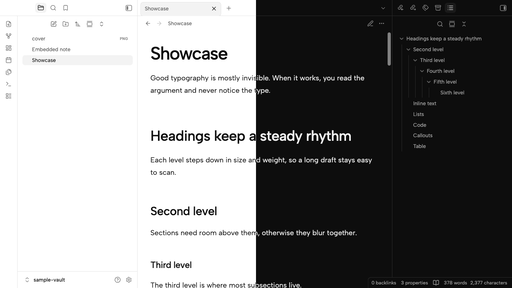

# Atrament

Atrament carries the "Minimum" design of [my blog](https://blog.mbratkowski.workers.dev) into
Obsidian: one typeface, black and white, and colour only where the blog has it, on post covers. The
whole vault looks like the blog, and a draft in the editor reads like the published post. The name is
Polish for ink, the text colour of the palette.



## Features

- **Palette.** The blog's black-and-white palette in light and dark mode. The accent is ink: Atrament
  ignores the accent colour set in Obsidian's settings by design.
- **Albert Sans, embedded.** Albert Sans (by Usted) is built into the theme for text and interface,
  with the Latin Extended glyphs Polish needs, so it works offline. A font you pick in Settings →
  Appearance still takes precedence.
- **Post typography.** Line height, heading scale, the note title and quotes follow the blog's posts:
  every `>` quote is the blog's pull quote, links have a thin underline, tags look like the blog's
  topic chips and footnote references read `[1]`.
- **Callout tints.** Callouts are flat cards tinted with the blog's post-cover colours, in both modes.
- **Flat interface.** Sidebars, tabs and the status bar share one background with hairline dividers;
  the main button is the blog's ink pill.
- **Plugins.** Kanban, Dataview and Calendar (Liam Cain) are styled to match. Other plugins follow
  through Obsidian's variables.

Atrament does not set the base font size; that stays your choice. The blog's body text is 18 px, and
that is the recommended setting: Settings → Appearance → Font size.

## Installation

From the community theme directory, once Atrament is listed: Settings → Appearance → Themes →
Manage, search for "Atrament", then install and use it.

Manually: copy `manifest.json` and `theme.css` into `<vault>/.obsidian/themes/Atrament/`, then pick
Atrament under Settings → Appearance → Themes.

## Development

Node 24 or newer and pnpm; there are no dependencies.

```sh
pnpm build                          # write theme.css from src/ and fonts/
pnpm check                          # theme rules, manifest and required files
pnpm test                           # tests for build, check and vault-install
pnpm vault:install --vault <path>   # copy manifest.json and theme.css into a vault
```

`src/` holds the theme in parts that the build joins in order: `fonts.css` (Albert Sans), `tokens.css`
(palette mapped to Obsidian's variables), `typography.css`, `editor.css` (note elements),
`interface.css` and `plugins.css`. Edit `src/`, not `theme.css`, which is built and committed.
`sample-vault/` holds a note with every styled element.

## Licences

The theme is released under the [MIT licence](LICENSE). Albert Sans is by Usted and is licensed under
the SIL Open Font License 1.1; see [`fonts/OFL.txt`](fonts/OFL.txt).
